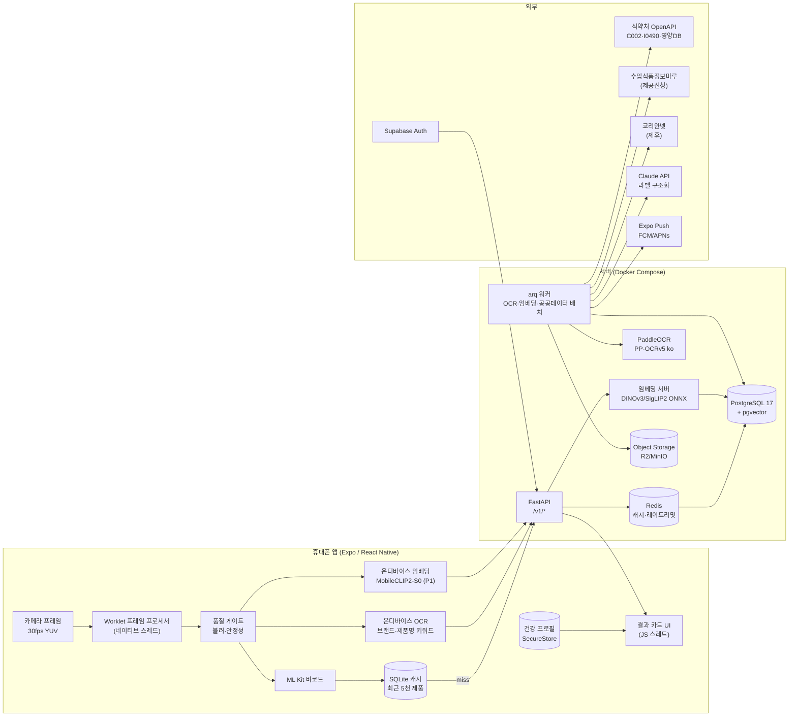
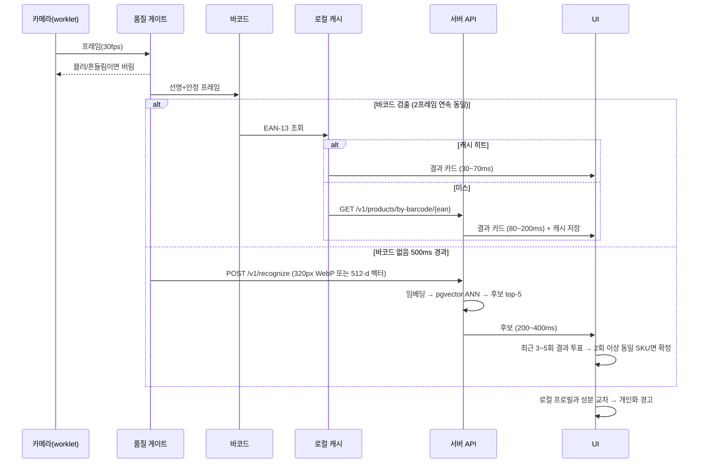
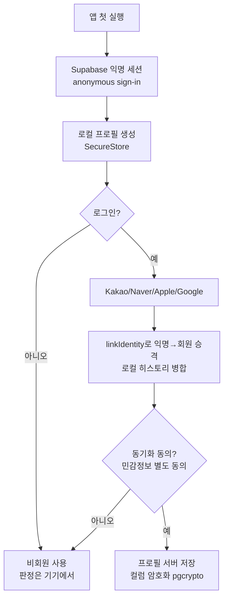

# 03. 기술 설계 — 시스템 아키텍처

> 이 문서는 "왜 이렇게 만드는가"를 개념부터 설명합니다. 용어는 처음 나올 때 풀어 씁니다.

## 1. 전체 구성도



**읽는 법**: 왼쪽(휴대폰)에서 가능한 한 많은 일을 끝내고, 서버에는 "모르는 것"만 묻습니다. 바코드가 보이면 서버 없이도 결과가 뜹니다.

## 2. 핵심 개념 설명

### 2-1. 왜 "프레임 프로세서"와 "worklet"인가

React Native 앱은 두 개의 스레드로 돌아갑니다.
- **JS 스레드**: 화면 그리기, 버튼 반응 등 앱 논리를 JavaScript로 실행.
- **네이티브 스레드**: 카메라, 센서 등 OS가 직접 다루는 일.

카메라는 초당 30장(30fps)의 이미지를 만듭니다. 이걸 JS 스레드로 보내면 매 프레임을 복사·변환해야 해서 느려지고 화면이 끊깁니다. **react-native-vision-camera의 프레임 프로세서**는 각 프레임을 JS로 보내지 않고 **네이티브 스레드에서 바로** 작은 함수(worklet)로 처리하게 해줍니다. 바코드 인식, 블러 검사, 임베딩 계산이 전부 여기서 일어나고, **결과(바코드 문자열, 벡터 1KB)**만 JS로 넘어갑니다. 이것이 "빠르다"의 기술적 핵심입니다.

### 2-2. 왜 바코드를 먼저 보는가

바코드는 **제품의 주민번호**입니다. 이미지 인식은 "이게 뭐처럼 생겼나"를 추측하지만, 바코드는 확정입니다. 그래서 순서는 항상:

1. 바코드 보이나? → 보이면 끝(0.03~0.2초).
2. 안 보이고 0.5초 지났나? → 그때 이미지 인식을 켠다(배터리·서버 절약).

### 2-3. 임베딩과 벡터 검색(이미지 인식의 원리)

이미지 인식 모델은 "이건 신라면이다"라고 **분류**하지 않습니다. 대신 사진을 **512개 숫자(벡터)**로 요약합니다. 같은 제품의 사진은 비슷한 벡터가 되도록 학습된 모델(DINOv3, MobileCLIP2 등)을 씁니다. 서버에는 제품마다 미리 계산한 벡터가 저장되어 있고, 새 사진의 벡터와 **가장 가까운 벡터**를 찾으면 그게 답입니다. 이걸 "최근접 이웃 검색(ANN)"이라 하고, PostgreSQL의 pgvector 확장이 HNSW라는 자료구조로 수백만 개 중에서 10~25ms에 찾아줍니다.

분류가 아니라 검색으로 만드는 이유: **새 제품이 나와도 모델을 다시 학습할 필요 없이 벡터 한 줄만 추가**하면 되기 때문입니다. Vivino, Google Lens가 모두 이 방식입니다.

## 3. 스캔 파이프라인 (3단 하이브리드)



### 3-1. 품질 게이트(왜 모든 프레임을 보내지 않는가)

- **블러 검사**: 128px 흑백으로 줄인 뒤 라플라시안 분산(가장자리가 얼마나 또렷한지)을 계산. 임계값은 기기별로 보정(문헌상 10~100).
- **안정성 검사**: 연속 프레임의 평균 픽셀 차이 + 자이로 각속도가 작을 때만 "안정". 300ms 안정이 지속될 때만 서버에 묻는다.
- **중복 제거**: 직전 전송 벡터와 코사인 유사도 0.97 이상이면 재전송 안 함. 진행 중인 요청이 있으면 새 요청으로 취소(AbortController).

### 3-2. 시간적 투표(왜 한 프레임만 믿지 않는가)

이미지 검색은 한 장으로는 틀릴 수 있습니다. 최근 3~5번 응답에서 같은 SKU가 2회 이상 + 최고 유사도가 임계 이상일 때만 "확정"으로 카드를 띄우고, 아니면 "조금 더 가까이 비춰주세요" 힌트를 줍니다. 사용자 체감으로는 0.1~0.2초의 추가 지연이지만 오인식이 크게 줄어듭니다.

### 3-3. 레이턴시 예산(p50 목표, ms)

| 단계 | 바코드 경로 | 비전(서버 임베딩) | 비전(온디바이스 임베딩, P1 후반) |
|---|---|---|---|
| 프레임 수신(worklet) | ~0 | ~0 | ~0 |
| 품질 게이트 | 2~5 | 2~5 | 2~5 |
| ML Kit 바코드 | 15~40 | — | — |
| GPU 리사이즈 224~320px | — | 3~5 | 3~5 |
| 온디바이스 임베딩(NPU) | — | — | 5~30 |
| 업로드(WebP 30KB vs 벡터 1KB) | 0(캐시) | 40~80 | 20~40 |
| 서버 임베딩(ONNX int8 CPU) | — | 25~50 | — |
| ANN + 메타 조회 | 10~30(미스 시) | 10~25 | 10~25 |
| 응답 + 렌더 | 10~20 | 15~25 | 15~25 |
| 시간적 투표 | 0~60 | 100~200 | 100~200 |
| **합계** | **30~70 / 80~200** | **200~400** | **150~330** |
| p95 목표 | < 300 | < 800 | < 600 |

(모두 추정치. M1 완료 시 실기기 측정으로 갱신.)

## 4. 데이터 플라이휠 — 이미지 갤러리를 공짜로 만드는 법

이미지 인식(P1)을 하려면 **제품마다 사진 몇 장**이 있어야 합니다. 이걸 사람이 찍으면 수만 장이 필요합니다. 대신:

1. MVP에서 사용자가 **바코드로 인식에 성공**하면, 같은 세션에서 품질 게이트를 통과한 **앞면 프레임 1~3장**을 (동의 하에, 320px로 줄여) 서버에 올린다.
2. 바코드가 곧 정답 라벨이므로 **사람 라벨링 없이** `product_images(product_id, image, embedding)`가 쌓인다.
3. SKU당 10장 이상 모이면 그 SKU는 "이미지 인식 가능" 플래그. 전체의 60% 이상이 되면 P1-1을 켠다.
4. 증강: 원근 왜곡·회전 ±15°·노출·모션블러·글레어 합성·부분 크롭으로 SKU당 1~3장에서도 시작 가능.

## 5. 앱 아키텍처 (Expo)

```
apps/mobile/
  app/                 Expo Router (파일 기반 라우팅)
    (tabs)/scan.tsx    카메라 홈
    (tabs)/history.tsx
    (tabs)/profile.tsx
    product/[id].tsx
    ocr.tsx
  src/
    camera/            VisionCamera 설정, 프레임 프로세서(worklet)
    native/            Nitro 플러그인 (Swift/Kotlin): 블러검사, 임베딩
    data/              SQLite 캐시, API 클라이언트(TanStack Query), 프로필 저장소
    domain/            개인화 판정 로직(순수 TS, 서버와 공유 가능)
    ui/                결과 카드, 배지, 등급 칩
```

- **상태 관리**: TanStack Query(서버 상태) + Zustand(UI 상태). Redux 불필요.
- **캐시**: expo-sqlite. `products` 테이블 LRU 5천 건, TTL 7일. 회수 정보는 TTL 1시간.
- **프로필**: expo-secure-store(iOS Keychain / Android Keystore). 서버 동기화는 opt-in.
- **빌드**: EAS Build(dev build 필수, Expo Go 불가 — VisionCamera 네이티브 모듈 때문). EAS Update로 JS 핫픽스.

## 6. 서버 아키텍처 (FastAPI)

```
apps/api/
  app/
    main.py            FastAPI 앱, 라우터 등록
    routers/           products, recognize, ocr, profiles, contributions, recalls
    services/          origin_resolver, grade_engine, allergen_matcher, caffeine
    ml/                embedder(ONNX), ocr(PaddleOCR), label_parser(regex+Claude)
    db/                SQLAlchemy 모델, Alembic 마이그레이션
    workers/           arq 태스크: mfds_sync, impfood_sync, embed_images, recall_poll
  tests/
docker-compose.yml     api, worker, postgres(pgvector), redis, minio
```

### 6-1. 공공데이터 동기화(배치)

식약처 API는 시간당 100~300회, 1회 1,000건 제한이라 **실시간 호출이 불가능**합니다([01-research.md](01-research.md) §2-1). 따라서:

- **초기 전체 덤프**: C002 전체(수십만 건)를 며칠에 걸쳐 1,000건씩 받아 `raw_mfds_c002` 테이블에 저장 → 정규화 파이프라인으로 `products`, `product_ingredients` 생성.
- **일배치 증분**: 매일 20시 이후 CHNG_DT 기준 최근 7일 변경분 조회.
- **회수(I0490)**: 1시간마다 폴링 → 바코드/품목제조번호 매칭 → 해당 제품 스캔·저장 사용자에게 푸시.
- 원본은 raw 테이블에 보존(출처 추적·재처리용).

### 6-2. 캐시 전략

| 대상 | 위치 | TTL |
|---|---|---|
| 바코드 → 제품 | 기기 SQLite → Redis → PG | 7일 / 1일 |
| 제품 상세(공개 데이터) | Cloudflare CDN | 1시간 |
| 임베딩 쿼리 결과 | Redis(벡터 해시 키) | 10분 |
| 회수 목록 | Redis | 1시간 |

### 6-3. 추론 배치

- 서버 임베딩은 **ONNX Runtime CPU(int8, 4스레드)**. ViT-S 224px 기준 20~50ms 추정. 초당 수십 쿼리까지 CPU로 충분.
- GPU(T4/A10)는 **갤러리 재임베딩·파인튜닝 때만** 스팟으로 사용.
- OCR(PaddleOCR)은 워커에서 비동기 처리, 결과는 WebSocket 대신 **폴링(1초)**로 단순화.

## 7. 인증·개인화 흐름



- **Apple 심사 4.8**: Kakao/Naver/Google 로그인을 제공하면 Sign in with Apple을 **동등하게** 노출해야 합니다. Apple 버튼 스타일 변경 금지.
- Naver는 Supabase 내장 provider가 아니라 **Custom OAuth2**로 등록(authorization/token/userinfo 엔드포인트 지정).
- 판정 로직(`domain/`)은 **순수 TypeScript**로 작성해 기기에서 실행. 서버는 성분 목록·등급만 내려준다 → 서버가 사용자의 알레르기를 몰라도 개인화가 동작.

## 8. 배포 토폴로지와 비용

| 단계 | 구성 | 월 비용(추정) |
|---|---|---|
| 개발 | Docker Compose 로컬 | 0 |
| MVP(베타) | NCP Standard-g1 2vCPU/4GB 1대 또는 AWS Lightsail 2GB(서울) + Compose 그대로 + Cloudflare R2 | 약 1.2~7만원 |
| 성장 | GCP Cloud Run(서울) + Cloud SQL(pgvector) + Memorystore | 10~30만원~ |
| ML 배치 | GPU 스팟(파인튜닝·재임베딩 시만) | 사용량 |

국내 사용자 RTT를 위해 **서울 리전** 고정. Fly.io는 도쿄가 최단(30~40ms).

## 9. 관측·운영

- 로깅: structlog JSON → Loki 또는 CloudWatch. 사용자 알레르기 등 민감정보는 **로그 마스킹**.
- 메트릭: 엔드포인트별 p50/p95, 바코드 매칭률, 인식 확정률, OCR 완료율(KPI와 연결).
- 에러: Sentry(앱+서버).
- 피처 플래그: 이미지 인식 on/off, 온디바이스 임베딩 on/off를 서버 설정으로 제어.
