# 04. 데이터 모델

> PostgreSQL 17 + pgvector 기준. 컬럼명은 snake_case. "왜 이 테이블이 필요한가"를 함께 적습니다.

## 1. ERD

```mermaid
erDiagram
  products ||--o{ product_barcodes : has
  products ||--|| product_origin : has
  products ||--o{ product_ingredients : has
  products ||--o{ product_images : has
  products ||--o{ product_nutrition : has
  products ||--o{ product_sources : "cited by"
  products ||--o{ scans : scanned
  products ||--o{ corrections : "corrected by"
  products ||--o{ recalls : "may have"
  ingredients ||--o{ product_ingredients : "appears in"
  ingredients ||--|| ingredient_hazard : graded
  ingredients ||--o{ ingredient_allergens : maps
  allergens ||--o{ ingredient_allergens : maps
  allergens ||--o{ allergen_jurisdictions : "listed in"
  product_ingredients ||--o{ ingredient_origins : "origin of"
  users ||--o{ profiles : owns
  users ||--o{ scans : made
  users ||--o{ corrections : filed
  profiles ||--o{ profile_allergens : selects

  products {
    uuid id PK
    text name
    text brand
    text manufacturer
    text category "food|cosmetic"
    text subcategory "김치류, 토너 ..."
    text mfds_report_no "품목제조번호"
    text image_url
    bool image_recognizable
    timestamptz updated_at
  }
  product_barcodes {
    text ean13 PK
    uuid product_id FK
    text source
  }
  product_origin {
    uuid product_id PK
    text declared_origin_country
    text manufacturing_country
    text manufacturer_name
    text manufacturer_country
    text brand_owner_name
    text brand_owner_country
    bool oem_flag
    text confidence "label_read|ocr|inferred"
    text source
  }
  product_ingredients {
    uuid id PK
    uuid product_id FK
    uuid ingredient_id FK
    int rank "표시 순서"
    text raw_text "라벨 원문"
    text source
  }
  ingredient_origins {
    uuid product_ingredient_id FK
    text country "KR|CN|US|외국산|unknown"
    text raw_text
    text source
    int confirmations
  }
  ingredients {
    uuid id PK
    text name_ko
    text name_en
    text inci_name
    text e_number
    text cas
    text_arr functions "감미료, 보존료, ..."
    text_arr synonyms
  }
  ingredient_hazard {
    uuid ingredient_id PK
    int grade "0..3"
    text evidence_level
    jsonb regulatory_status "KR/EU/US"
    text_arr applies_to_groups "pku, child, kidney, pet"
    text summary_ko
    text_arr source_urls
    date last_reviewed
  }
  allergens {
    text code PK "egg, milk, tree_nut.walnut"
    text name_ko
    text parent_code
  }
  allergen_jurisdictions {
    text allergen_code FK
    text jurisdiction "KR|EU|US|JP"
    bool mandatory
  }
  product_images {
    uuid id PK
    uuid product_id FK
    text storage_key
    vector embedding "halfvec(512)"
    text model_version
    text source "user_barcode_session|seed"
  }
  product_nutrition {
    uuid product_id FK
    numeric serving_g
    numeric kcal
    numeric sodium_mg
    numeric sugar_g
    numeric sat_fat_g
    numeric trans_fat_g
    numeric protein_g
    numeric caffeine_mg
    bool high_caffeine
    text source
  }
  recalls {
    uuid id PK
    uuid product_id FK
    text mfds_id
    text reason
    text grade
    date issued_at
  }
  users {
    uuid id PK "Supabase auth.users.id"
    timestamptz created_at
  }
  profiles {
    uuid id PK
    uuid user_id FK
    text label "나, 아이"
    bytea encrypted_payload "민감정보, pgcrypto"
    bool sync_consent
  }
  scans {
    uuid id PK
    uuid user_id FK "nullable (비회원)"
    uuid product_id FK
    text method "barcode|vision|ocr|search"
    int latency_ms
    timestamptz created_at
  }
  corrections {
    uuid id PK
    uuid product_id FK
    uuid user_id FK
    text field
    text proposed_value
    text evidence_url
    text status "open|accepted|rejected"
  }
```



## 2. 핵심 테이블 설명

### 2-1. `product_origin` — 원산지는 한 칸이 아니다

법적으로 "원산지"는 최소 4가지를 뜻합니다([08-legal-privacy.md](08-legal-privacy.md) §1). 한 칸에 "중국"이라고 쓰면 **브랜드는 한국인데 공장이 중국인 제품**과 **원료 하나만 중국산인 제품**이 같아 보이는 오답이 납니다. 그래서 분리합니다.

| 컬럼 | 뜻 | 예시(국내 브랜드 OEM 화장품) |
|---|---|---|
| `declared_origin_country` | 라벨에 적힌 "원산지" | 한국 |
| `manufacturing_country` | 실제 공장 국가(화장품은 의무 표기, 식품은 제조원 주소로 추정) | 중국 |
| `manufacturer_name/country` | 제조업자 | ○○코스메틱(중국) |
| `brand_owner_name/country` | 책임판매업자/유통전문판매원 | △△뷰티(한국) |
| `oem_flag` | 제조업자 ≠ 브랜드 | true |
| `confidence` | 어떻게 알았나 | `label_read`(사람이 라벨 확인) > `ocr` > `inferred`(주소로 추정) |

원재료별 원산지는 `ingredient_origins`에 **원료 단위**로 넣고, 값에 `unknown`을 허용합니다. **표시 의무가 없는 원료(4순위 이하, 첨가물)는 `unknown`**이며 UI는 "알 수 없음"으로 보여줍니다.

### 2-2. `ingredient_hazard` — 등급과 근거를 분리

화해·Yuka 비판의 핵심은 "왜 이 등급인지 모른다"입니다. 그래서 한 성분에 대해:

- `grade` 0~3 ([05-knowledge-base.md](05-knowledge-base.md) §2 기준표)
- `evidence_level`: `regulatory`(규제기관 결론) / `systematic`(체계적 문헌) / `observational`(관찰연구) / `animal_cell`(동물·세포)
- `regulatory_status`: `{"KR":"허용","EU":"금지(2022)","US":"허용"}` 처럼 국가별 상태 → "EU 금지" 배지
- `applies_to_groups`: 특정 집단에만 해당하는 주의(`pku`, `child`, `kidney`, `pregnancy`, `pet`)
- `source_urls`, `last_reviewed`: 모든 등급은 출처와 검토일이 있어야 저장 가능(DB 제약)

### 2-3. 알레르겐 온톨로지

한국 19항목, EU 14종, 미국 9종, 일본 9종은 묶는 단위가 다릅니다(한국은 "조개류", EU는 "연체류", 미국은 견과를 통째로). 그래서 **가장 작은 단위를 코드로** 두고 각 나라 목록은 매핑 테이블로 둡니다.

```
allergens.code 예시
  egg, milk, buckwheat, peanut, soy, wheat, mackerel,
  shellfish.crustacean.crab, shellfish.crustacean.shrimp,
  pork, peach, tomato, sulfite, tree_nut.walnut, chicken, beef,
  mollusc.squid, mollusc.oyster, mollusc.abalone, mollusc.mussel, tree_nut.pine_nut,
  sesame, celery, mustard, lupin, fish (EU/US 추가분)
```

`allergen_jurisdictions(KR, mandatory=true)`가 19항목. 사용자 프로필은 코드 단위로 저장하므로 "호두만 알레르기"처럼 세분화 가능.

`product_allergens`는 별도 테이블 대신 `product_ingredients` → `ingredient_allergens` 조인으로 계산하되, 라벨의 **"혼입 가능"** 문구는 `product_may_contain(product_id, allergen_code)`에 따로 저장합니다(포함 ≠ 혼입 가능).

### 2-4. `product_images` + pgvector

- `embedding halfvec(512)`: 16비트 부동소수점으로 저장해 용량 절반.
- 인덱스: `CREATE INDEX ON product_images USING hnsw (embedding halfvec_cosine_ops)`.
- `model_version`: 모델을 바꾸면 전체 재임베딩이 필요하므로 버전을 기록. 두 버전이 공존하는 기간엔 쿼리 시 버전 필터.
- SKU 단위 집계: 쿼리 결과 top-20 이미지를 `product_id`로 묶어 다수결 + 최고 유사도.

### 2-5. `profiles` — 민감정보 처리

알레르기·임신·질환은 개인정보보호법상 **민감정보**입니다. 서버에 저장하는 경우(동기화 opt-in)에만 행이 생기고, 내용은 `encrypted_payload`에 pgcrypto로 암호화해 넣습니다. 쿼리로 "땅콩 알레르기 사용자 목록"을 뽑을 수 없게 **의도적으로 검색 불가 구조**입니다. 회수 푸시 같은 기능은 `scans`(어떤 제품을 봤나)만으로 동작하므로 프로필 복호화가 필요 없습니다.

### 2-6. `product_sources` — 출처 추적

모든 사실 필드는 어디서 왔는지 남깁니다.

| source 값 | 뜻 |
|---|---|
| `mfds_c002` | 식약처 품목제조보고 |
| `mfds_i0490` | 회수 정보 |
| `impfood` | 수입식품정보마루 |
| `koreannet` | 코리안넷(제휴 시) |
| `ocr_user` | 사용자 라벨 OCR(미검증) |
| `ocr_verified` | 3명 이상 동일 값 |
| `manufacturer` | 제조사 정정 채널 |
| `curator` | 내부 검수 |

UI의 "출처" 줄은 이 테이블에서 생성됩니다.

## 3. 원재료 원문 → 정규화 파이프라인

C002의 `RAWMTRL_NM`은 이런 문자열입니다.

```
"배추(국산), 고춧가루(중국산), 마늘, 정제소금, 새우젓(새우:국산), 설탕, L-글루탐산나트륨(향미증진제)"
```

정규화 단계:
1. 쉼표 분리(괄호 안 쉼표는 스택 파서로 보호).
2. 괄호에서 `(국산)`, `(중국산)`, `(새우:국산)`, `(외국산(미국,브라질))` 패턴을 원산지로 추출 → `ingredient_origins`.
3. 괄호에서 용도(`향미증진제`, `감미료`)를 추출 → `ingredients.functions` 보강.
4. 성분명을 `ingredients.synonyms`와 매칭(예: "L-글루탐산나트륨" = MSG = E621). 미매칭은 `unmapped_ingredients` 큐로 → 주 1회 Claude 보조 + 사람 검수.
5. `ingredient_allergens`로 알레르겐 계산.

## 4. 인덱스·성능 메모

- `product_barcodes(ean13)` PK → 바코드 조회 O(1).
- `products` 전문검색: `pg_trgm` GIN 인덱스(한국어 n-gram 검색에 충분, MVP 범위).
- `scans(user_id, created_at desc)`.
- 회수 매칭: `recalls(product_id)` + `product_barcodes` 조인.
