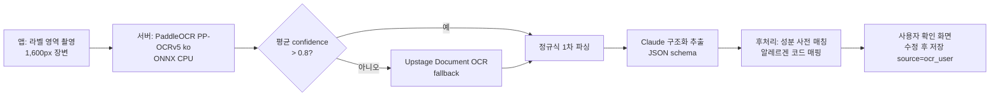

# 06. API와 ML 파이프라인

## 1. API 설계 원칙

- 베이스: `https://api.eodisan.app/v1`. JSON, HTTP/2 keep-alive(gRPC 불필요).
- 인증: Supabase JWT를 `Authorization: Bearer`로. 비회원은 익명 세션 JWT(동일 경로).
- 공개 제품 데이터 GET은 `Cache-Control: public, max-age=3600` → CDN 캐시.
- 에러: RFC 9457 `application/problem+json`.
- 모든 응답에 `sources[]`(출처)와 `generated_at` 포함.

## 2. 엔드포인트

| 메서드 | 경로 | 역할 | 지연 목표 |
|---|---|---|---|
| GET | `/products/by-barcode/{ean13}` | 바코드 → 제품 요약 카드 | p50 < 60ms |
| GET | `/products/{id}` | 상세(원산지·성분·영양·출처) | < 80ms |
| GET | `/products/search?q=` | 텍스트 검색(pg_trgm) | < 120ms |
| POST | `/recognize` | 이미지(WebP ≤40KB) 또는 벡터(512-d) → 후보 top-5 | < 150ms(서버 측) |
| POST | `/ocr/label` | 고해상도 라벨 1장 → `job_id` | 비동기 |
| GET | `/ocr/jobs/{id}` | 파싱 결과(원재료·원산지·알레르기·카페인) | 폴링 1s |
| POST | `/contributions/images` | 바코드 세션 프레임 기여(동의 시) | 비동기 |
| POST | `/contributions/corrections` | 정정 요청 | |
| GET | `/recalls?since=` | 회수 목록 증분 | CDN |
| GET/PUT | `/me/profiles` | 프로필 동기화(opt-in, 암호화 payload) | |
| GET/POST | `/me/scans` | 히스토리 동기화 | |
| GET | `/products/{id}/alternatives?profile=` | 대체 제품(P1) | |
| GET | `/kb/ingredients/{id}` | 성분 상세·근거 | CDN |

### 응답 예시 — `/products/by-barcode/8801234567890`

```json
{
  "product": {
    "id": "…", "name": "포기김치 1kg", "brand": "○○", "category": "food", "subcategory": "김치류",
    "image_url": "…"
  },
  "origin": {
    "manufacturing_country": "KR",
    "brand_owner_country": "KR",
    "oem": false,
    "ingredients": [
      {"name": "배추", "rank": 1, "country": "KR", "source": "ocr_verified"},
      {"name": "고춧가루", "rank": 2, "country": "CN", "source": "ocr_verified"},
      {"name": "마늘", "rank": 3, "country": "KR", "source": "ocr_user"}
    ],
    "undisclosed_note": "4순위 이하 원료는 표시 의무 없음",
    "confidence": "ocr"
  },
  "ingredients": [
    {"id": "…", "name": "L-글루탐산나트륨", "function": "향미증진제", "grade": 0, "evidence": "regulatory"}
  ],
  "grade_summary": {"0": 12, "1": 1, "2": 0, "3": 0, "unknown": 1},
  "allergens": {"contains": ["shellfish.crustacean.shrimp", "soy"], "may_contain": ["wheat"]},
  "nutrition": {"per_serving_g": 100, "sodium_mg": 620, "sugar_g": 3, "caffeine_mg": null},
  "recall": null,
  "sources": [
    {"type": "mfds_c002", "date": "2025-03-02"},
    {"type": "ocr_verified", "date": "2026-09-14", "confirmations": 3}
  ],
  "generated_at": "2026-10-13T06:00:00Z"
}
```

**개인화 경고는 응답에 없습니다.** 기기가 `allergens`·`ingredients`·`nutrition`을 로컬 프로필과 교차해 계산합니다([03-architecture.md](03-architecture.md) §7).

## 3. 라벨 OCR 파이프라인



### 3-1. 정규식 1차
```
원재료명\s*[:：]\s*(.+?)(?=\n\s*(?:내용량|보관방법|포장재질|품목보고번호|유통기한|소비기한)|$)
(원산지|제조국|원료\s*원산지)\s*[:：]\s*(.+)
카페인\s*(?:함량)?\s*[:：]?\s*(\d+(?:\.\d+)?)\s*mg
```
괄호 중첩(`대두(외국산(미국,브라질))`)은 스택 파서로 처리.

### 3-2. Claude 구조화 추출
- 모델: 품질 우선 경로 `claude-opus-5-5`, 대량 배치·저지연 경로 `claude-haiku-5-5`(eval로 품질 확인 후).
- `output_config.format`에 JSON 스키마 지정:
```json
{
  "ingredients": [{"name": "string", "origin": "string|null", "sub_ingredients": ["string"], "function": "string|null"}],
  "country_of_origin": "string|null",
  "manufacturing_country": "string|null",
  "manufacturer": "string|null",
  "brand_owner": "string|null",
  "allergen_statement": "string|null",
  "may_contain_statement": "string|null",
  "caffeine_mg": "number|null",
  "ocr_corrections": [{"from": "string", "to": "string"}]
}
```
- 프롬프트 원칙: "라벨에 없는 값은 null. 추정 금지." OCR 오탈자 교정은 `ocr_corrections`에 남겨 감사 가능.
- 비용 통제: 동일 바코드의 파싱 결과는 DB 캐시, 재OCR 금지. 월 OCR 건수 상한 피처 플래그.

### 3-3. 온디바이스 OCR의 역할
ML Kit Text Recognition v2(Korean) / Apple Vision(`ko-KR`)은 **실시간 키워드 추출**(브랜드명·제품명 큰 글씨)에만 씁니다. 비Latin 문자는 느려서 전체 라벨 파싱엔 부적합. 추출된 키워드는 `/recognize`의 보조 신호(텍스트 임베딩 융합, P1).

## 4. 이미지 인식 ML 계획

### 4-1. 모델 선택

| 위치 | 모델 | 이유 |
|---|---|---|
| 서버(초기) | **DINOv3 ViT-S/16**(Meta, distilled) | 자기지도 학습, 인스턴스 검색에 강함. A10 fp16 8ms, CPU int8 20~50ms 추정 |
| 서버(대안) | SigLIP2 B/16-256(Apache-2.0, 768-d) | 텍스트(브랜드명)와 같은 공간 → OCR 키워드 융합 검색 가능 |
| 온디바이스(P1 후반) | **MobileCLIP2-S0**(Apple, 11.4M) | iPhone NPU ~1.5ms, Core ML 제공. Android는 ExecuTorch/TFLite |

경험칙: 범용 CLIP은 소매 선반 top-1 약 41%, 도메인 파인튜닝 후 약 89%(업계 블로그 수치) → **파인튜닝 필수**.

### 4-2. 학습 데이터
- 사전학습/파인튜닝 보조: Products-10K(1만 SKU), RP2K(매장 선반 35만장), Stanford Online Products, Grocery Store Dataset.
- 한국 SKU 갤러리: **바코드 세션 플라이휠**([03-architecture.md](03-architecture.md) §4) + 초기 시드(팀 직접 촬영 500 SKU × 5장).
- 증강: 원근 ±15°, 회전, 색온도·노출, 모션블러, 글레어 합성, 배경 copy-paste, 부분 크롭(앞면 1/2, 1/3). 단일 이미지 3D 시점 합성(와인 라벨 논문 arXiv 2404.08820 방식)은 SKU당 사진이 적을 때 유효.

### 4-3. 학습
- 목적함수: metric learning(SupCon 또는 ArcFace), SKU = 클래스. 하드 네거티브 = 같은 브랜드 다른 맛(신라면 vs 신라면 블랙).
- 평가: held-out 사용자 프레임 top-1/top-5, 카테고리별(음료 캔·봉지·화장품 병) 분해. 목표 top-1 ≥ 85% @ 확정 임계.
- 검색 시 SKU 집계: top-20 이미지를 product_id로 묶어 **다수결 + 최고 유사도**. 확정 임계 미만이면 "후보 3개" UI.

### 4-4. 모델 export와 배포
- 서버: PyTorch → ONNX → ONNX Runtime(int8 동적 양자화). `model_version` 기록, 갤러리 재임베딩은 워커 배치.
- 온디바이스: iOS Core ML(Apple 제공 아티팩트), Android ExecuTorch `.pte`(XNNPACK int8) 또는 TFLite. 앱 번들 ≤ 15MB 목표.
- 모델 교체 시 **서버 갤러리 임베딩과 앱 모델 버전이 일치**해야 하므로, 앱은 `/recognize`에 `model_version`을 보내고 서버가 불일치 시 이미지 경로로 폴백.

## 5. 서버 임베딩 서비스

```python
# apps/api/app/ml/embedder.py (개념)
class Embedder:
    def __init__(self, onnx_path, threads=4):
        self.sess = ort.InferenceSession(onnx_path, providers=["CPUExecutionProvider"])
    def __call__(self, img: PIL.Image) -> np.ndarray:  # (512,) float16, L2-normalized
        x = preprocess(img, size=224)
        v = self.sess.run(None, {"input": x})[0][0]
        return (v / np.linalg.norm(v)).astype(np.float16)
```
pgvector 쿼리:
```sql
SELECT product_id, 1 - (embedding <=> $1) AS sim
FROM product_images
WHERE model_version = $2
ORDER BY embedding <=> $1
LIMIT 20;
```
HNSW 파라미터 시작값: `m=16, ef_construction=200`, 쿼리 `ef_search=64`.

## 6. 테스트 전략

| 레벨 | 대상 | 도구 |
|---|---|---|
| 단위 | 원재료 파서, 알레르겐 매핑, 카페인 계산, 원산지 문구 생성 | pytest(서버), vitest(앱 domain/) |
| 계약 | OpenAPI 스키마 ↔ 앱 타입(openapi-typescript) | CI |
| 데이터 | KB 시드 무결성(등급엔 출처·검토일 필수) | pytest + DB 제약 |
| ML | 인식 top-1/top-5 회귀, OCR 파싱 정확도 골든셋 100장 | 주간 배치 |
| E2E | 바코드 스캔 → 카드 표시 지연 | Maestro(실기기) |
